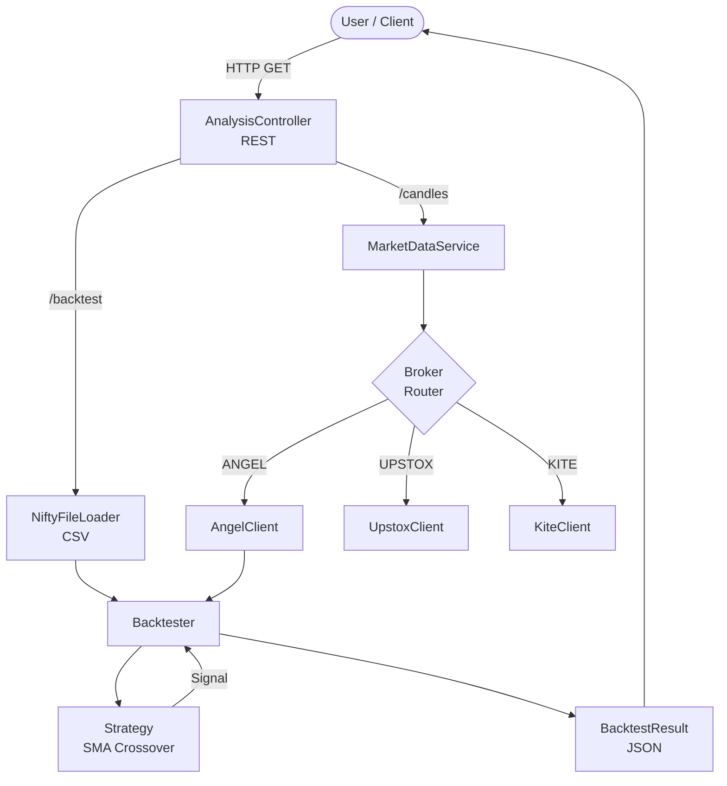
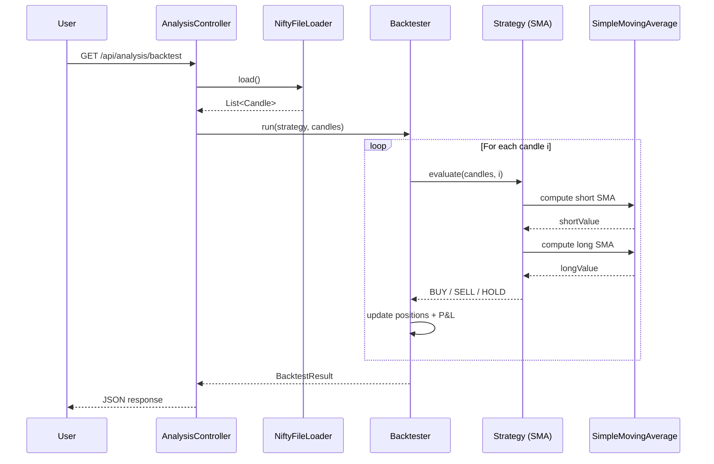
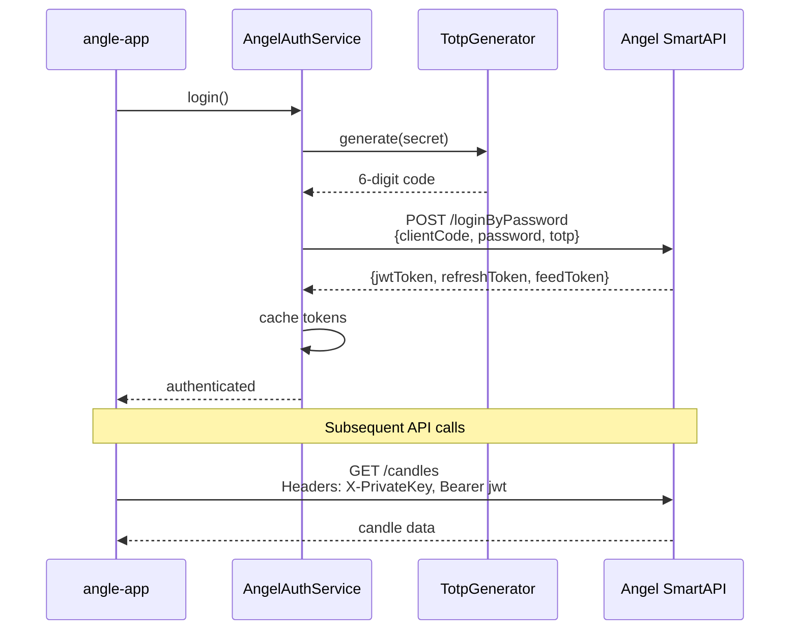
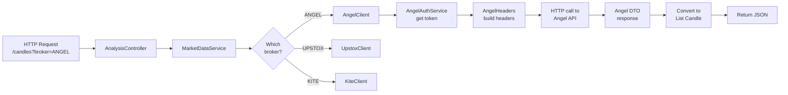
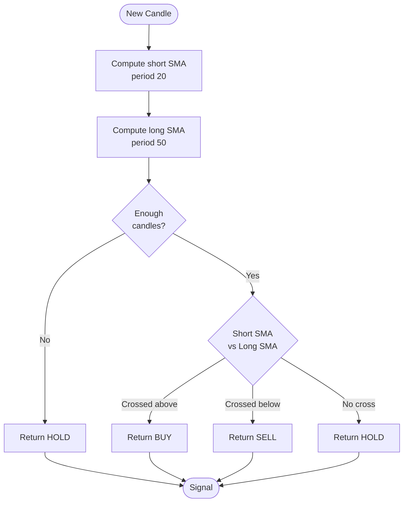
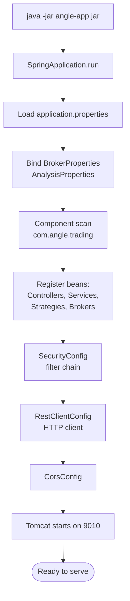
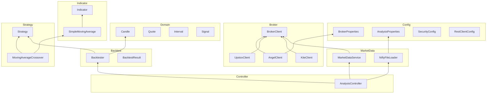
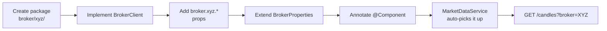

# Flow Diagrams

Visual flows of how the angle-app works.

> For candle-specific DFD (cache layers, gap-fill, save path, CandleHistoryJob)
> see → [CANDLE-HISTORY.md](./CANDLE-HISTORY.md)

---

## Table of Contents

### Original Diagrams (Mermaid — view on GitHub or any Mermaid-aware viewer)

- [A1. High-Level System Flow](#a1-high-level-system-flow)
- [A2. Backtest Flow](#a2-backtest-flow)
- [A3. Angel One Auth Flow (original)](#a3-angel-one-auth-flow-original)
- [A4. Live Candles Fetch Flow](#a4-live-candles-fetch-flow)
- [A5. Strategy Decision Flow (SMA Crossover)](#a5-strategy-decision-flow-sma-crossover)
- [A6. Application Startup Flow](#a6-application-startup-flow)
- [A7. Package / Layer Dependency](#a7-package--layer-dependency)
- [A8. Adding a New Strategy](#a8-adding-a-new-strategy)
- [A9. Adding a New Broker](#a9-adding-a-new-broker)

### Current System Diagrams (ASCII — works in any editor)

1. [System Overview](#1-system-overview)
2. [Angel One Auth Flow](#2-angel-one-auth-flow)
3. [Request → Response (Web Layer)](#3-request--response-web-layer)
4. [Live Stream → Signal Detection](#4-live-stream--signal-detection)
5. [Bias Dashboard Flow](#5-bias-dashboard-flow)
6. [Signal Detection Pipeline](#6-signal-detection-pipeline)
7. [F&O Screener Flow](#7-fo-screener-flow)
8. [Trade Journal CRUD](#8-trade-journal-crud)
9. [Paper Trading / Backtest Replay](#9-paper-trading--backtest-replay)
10. [Scheduled Jobs Timeline](#10-scheduled-jobs-timeline)
11. [Security / Auth Flow](#11-security--auth-flow)
12. [Package Dependency Map](#12-package-dependency-map)

---

## 1. System Overview

```
┌─────────────────────────────────────────────────────────────────────────┐
│                          EXTERNAL                                        │
│                                                                          │
│  Angel One REST API        Angel One WebSocket      Anthropic API        │
│  (historical candles,      (live ticks,             (AI signals,         │
│   LTP, auth)                market stream)           portfolio picks)    │
└──────────┬─────────────────────────┬────────────────────────┬───────────┘
           │                         │                        │
           ▼                         ▼                        ▼
┌──────────────────────────────────────────────────────────────────────────┐
│                            angle-app  :9010                               │
│                                                                           │
│  ┌──────────────┐   ┌─────────────────┐   ┌──────────────────────────┐  │
│  │  Web Layer   │   │  Analysis Layer │   │     AI Layer             │  │
│  │              │   │                 │   │                          │  │
│  │  Thymeleaf   │   │  SignalDetector │   │  AiSignalService         │  │
│  │  pages       │   │  8 strategies   │   │  AiPickService           │  │
│  │  REST APIs   │   │  BiasWarmer     │   │  AnalystService          │  │
│  └──────┬───────┘   └────────┬────────┘   └─────────────────────────-┘  │
│         │                    │                                            │
│         └────────────────────┴────────────────┐                          │
│                                               ▼                          │
│                              ┌────────────────────────────┐              │
│                              │     MarketDataService      │              │
│                              │  (single candle entry pt)  │              │
│                              └───────────────┬────────────┘              │
│                                              │                           │
│                              ┌───────────────▼────────────┐              │
│                              │  CandleCache  L1→L2→L3     │              │
│                              │  Caffeine→Redis→MySQL      │              │
│                              └───────────────┬────────────┘              │
│                                              │                           │
└──────────────────────────────────────────────┼───────────────────────────┘
                                               │
                   ┌───────────────────────────┼────────────────┐
                   ▼                           ▼                ▼
            ┌────────────┐            ┌──────────────┐   ┌────────────┐
            │  Caffeine  │            │    Redis     │   │   MySQL    │
            │  (L1 60s)  │            │  (L2 5 min)  │   │  (L3 365d) │
            └────────────┘            └──────────────┘   └────────────┘
```

---

## 2. Angel One Auth Flow

```
angle-app startup
      │
      ▼
AngelAuthService.login()
      │
      ├──► TotpGenerator.generate(secret)
      │         └──► 6-digit TOTP code
      │
      ├──► POST https://apiconnect.angelone.in/loginByPassword
      │         body: { clientCode, password, totp }
      │
      │    ◄── { jwtToken, refreshToken, feedToken }
      │
      ├──► cache tokens in memory
      │
      └──► all subsequent API calls use:
               Header: X-PrivateKey: {apiKey}
               Header: Authorization: Bearer {jwtToken}
               Header: X-Feed-Token: {feedToken}  (for WebSocket)

Token refresh:
      AngelAuthService monitors expiry
      → auto-refresh via POST /generateTokens
      → no re-login needed during session
```

---

## 3. Request → Response (Web Layer)

```
Browser
  │
  │  GET /bias  (or /screener, /journal, /dashboard, ...)
  ▼
Spring Security Filter Chain
  │
  ├── Chain 1: /api/**     → stateless HTTP Basic (for curl / REST clients)
  ├── Chain 2: /actuator/** → ROLE_ADMIN only
  ├── Chain 3: /admin/**   → ROLE_ADMIN + form login
  └── Chain 4: /**         → any authenticated user + form login
        │
        │  if not logged in → redirect to /auth/login
        │  if logged in → pass through
        ▼
Thymeleaf Controller
  (BiasController, ScreenerController, JournalController, ...)
        │
        ├──► service calls (BiasSheetService, FoScreenerService, ...)
        │         └──► MarketDataService.getCandles()
        │                   └──► CandleCache (L1→L2→L3→Angel)
        │
        ├──► model.addAttribute(data)
        │
        └──► return "template/page"
                  └──► Thymeleaf renders HTML
                            └──► response to browser
```

---

## 4. Live Stream → Signal Detection

```
Angel One WebSocket
  wss://smartapisocket.angelone.in/smart-stream
        │
        │  tick every ~1 second (LTP per subscribed token)
        ▼
  LiveStreamService
        │  maintains connection, reconnects on drop
        │  heartbeat every 30s
        ▼
  CandleAggregator          ← sweeps every 1 second
        │
        │  accumulates ticks into OHLCV bars
        │  tracks open/high/low/close/volume per interval
        │
        │  when bar boundary reached (e.g. 09:15 → 09:20 for 5m):
        ▼
  CandleClosedEvent fired    ← Spring application event
  { exchange, token, interval, candle }
        │
        │  [async, @EventListener]
        ▼
  SignalDetector.onCandleClosed()
        │
        ├──► fetch last 250 candles from cache (usually L1 hit, fast)
        │
        ├──► check regime (ADX, VIX, time filter)
        │         if regime = ranging → skip signal generation
        │
        ├──► check news blackout
        │         if high-impact event → skip
        │
        ├──► run 8 strategies in parallel
        │         macd-crossover, rsi-mean-reversion, bollinger-bounce,
        │         ob-retest, volume-breakout, moving-average-crossover,
        │         sweep-fvg, ensemble
        │
        ├──► count agreements (consensus)
        │         if agreedCount < threshold → no signal
        │
        ├──► check MTF confirmation (15m, 1h agree?)
        │
        ├──► dedupe check (same signal in last N minutes?)
        │
        └──► save SignalEntity (OPEN) → DB
                  └──► LiveSignalMonitor picks it up
                            └──► monitors LTP for target/stop hit
```

---

## 5. Bias Dashboard Flow

```
User opens /bias
      │
      ▼
BiasController.page()
      │
      ▼
BiasSheetService.build(instrument)
      │
      ├──► getCandles(5m,  last 5 days)
      ├──► getCandles(15m, last 10 days)
      ├──► getCandles(1h,  last 20 days)
      │         └──► all via CandleCache (fast if warmed)
      │
      ├──► compute indicators on each timeframe:
      │         EMA9, EMA20, EMA50, EMA200
      │         RSI(14)
      │         MACD(12,26,9)
      │         ADX(14), +DI, -DI
      │         Supertrend(10, 3.0)
      │         Bollinger Bands(20, 2.0)
      │
      ├──► determine bias per timeframe:
      │         BULLISH / BEARISH / NEUTRAL
      │         based on EMA stack + RSI + MACD alignment
      │
      ├──► VixService   → VIX level (fear gauge)
      ├──► BreadthService → advance/decline ratio
      ├──► CorrelatedService → SGX Nifty, Dow, DXY
      │
      └──► return BiasSheet
                  └──► render bias/index.html
                            → timeframe matrix
                            → trend filters
                            → trade plan suggestion
```

---

## 6. Signal Detection Pipeline

```
                    ┌─────────────────────────────────┐
                    │         PIPELINE STAGES         │
                    └─────────────────────────────────┘

CandleClosedEvent
      │
      ▼
 [GATE 1] RegimeService
      │  ADX-based regime: TREND / MIXED / RANGE
      │  VIX filter: skip if VIX > 22
      │  Time filter: only 09:30–12:00, 14:00–15:00
      │  Market holiday check
      │
      ▼ pass
 [GATE 2] NewsBlackoutService
      │  checks if high-impact event in next 30 min
      │
      ▼ pass
 [STRATEGIES] run all 8 in parallel
      │
      │  each returns: BUY / SELL / HOLD
      │
      ▼
 [CONSENSUS] count BUY votes
      │  threshold: e.g. 3 of 8 strategies must agree
      │
      ▼ pass
 [MTF CONFIRM] MtfConfirmationService
      │  15m + 1h candles must align with signal direction
      │
      ▼ pass
 [DEDUPE] SignalRepository.countRecent()
      │  same token + action in last N minutes? → skip
      │
      ▼ pass
 [SAVE] SignalEntity { status=OPEN }
      │  entry, stop, target calculated
      │
      ▼
 [MONITOR] LiveSignalMonitor
      │  polls LTP every minute
      │  LTP ≥ target → status=HIT_TARGET
      │  LTP ≤ stop   → status=HIT_STOP
      │  expired      → status=EXPIRED
      │
      ▼
 [TRAIL] TrailingStopService
        if PnL ≥ activation threshold:
        tighten stop as price moves in favour
```

---

## 7. F&O Screener Flow

```
User opens /screener  OR  CandleHistoryJob (planned, Sat 10 AM)
      │
      ▼
FoScreenerService.scan(forceRefresh)
      │
      ├──► check in-memory cache (15 min TTL)
      │         HIT → return cached rows instantly
      │
      │         MISS → doScan()
      │                   │
      │                   ▼
      │            for each enabled instrument (up to 50):
      │                   │
      │                   ├──► getCandles(1D, last 260 days)
      │                   │         └──► CandleCache → MySQL → Angel
      │                   │
      │                   ├──► compute on 260 daily candles:
      │                   │         ADX(14)   → trend strength
      │                   │         RSI(14)   → momentum
      │                   │         EMA50     → short trend
      │                   │         EMA200    → long trend
      │                   │         ATR(14)   → daily move size
      │                   │
      │                   ├──► score 0–6:
      │                   │         +1  ADX > 25    (strong trend)
      │                   │         +1  ADX > 35    (very strong)
      │                   │         +1  close > EMA200
      │                   │         +1  EMA50 > EMA200
      │                   │         +1  RSI 40–65
      │                   │         +1  open signal exists
      │                   │
      │                   └──► build ScreenerRow
      │
      ├──► sort: score DESC, then ADX DESC, errors last
      │
      └──► render screener/index.html
                  → score badges (green ≥ 4, yellow = 3, grey ≤ 2)
                  → criteria dots per instrument
                  → guide section
```

---

## 8. Trade Journal CRUD

```
┌───────────────────────────────────────────────────────────────┐
│  URL                    │ Method │ Action                      │
├───────────────────────────────────────────────────────────────┤
│  /journal               │ GET    │ list all trades + stats     │
│  /journal?outcome=WIN   │ GET    │ filter by outcome           │
│  /journal?segment=NSE   │ GET    │ filter by segment           │
│  /journal?q=NIFTY       │ GET    │ search by symbol            │
│  /journal/new           │ GET    │ show blank form             │
│  /journal/save          │ POST   │ create trade entry          │
│  /journal/{id}          │ GET    │ detail view                 │
│  /journal/{id}/edit     │ GET    │ show pre-filled form        │
│  /journal/{id}/update   │ POST   │ update existing entry       │
│  /journal/{id}/delete   │ POST   │ delete entry                │
└───────────────────────────────────────────────────────────────┘

Save flow:
      POST /journal/save
            │
            ▼
      TradeJournalController.save()
            │
            ├──► computeOutcome()
            │         exitPrice present?
            │           YES → PnL = (exit - entry) × qty
            │                 outcome = WIN / LOSS / BREAKEVEN
            │           NO  → outcome = OPEN, pnl = null
            │
            ├──► indicators = join(String[], ",")
            │         e.g. ["RSI","ADX","ORB"] → "RSI,ADX,ORB"
            │
            ├──► repo.save(entity)
            │         → INSERT INTO trade_journal
            │
            └──► redirect to /journal/{id}  (detail page)
```

---

## 9. Paper Trading / Backtest Replay

```
POST /api/paper/sessions
  body: { strategy, symbol, from, to, candlesPerSecond }
        │
        ▼
PaperTradingSessionManager.create()
        │
        ▼
PaperTradingSession (runs async)
        │
        ├──► source = AngelHistoricalReplayCandleSource
        │         └──► getCandles(interval, from, to)
        │                   └──► CandleCache → MySQL → Angel
        │
        ├──► replay candles at candlesPerSecond speed
        │         e.g. 30 CPS = 1 day replayed in ~3 seconds
        │
        │    for each candle:
        │         ├──► fire CandleClosedEvent (same as live)
        │         ├──► strategy.evaluate(candles, i)
        │         │         → BUY / SELL / HOLD
        │         ├──► open/close paper position
        │         └──► track P&L
        │
        └──► session complete → SessionEntity saved
                  └──► GET /api/paper/sessions/{id}
                            returns: trades, P&L, win rate, etc.

Same strategy code path as live trading.
Only difference: candle source is historical replay, not live stream.
```

---

## 10. Scheduled Jobs Timeline

```
TIME (IST)          JOB                      WHAT IT DOES
──────────────────────────────────────────────────────────────────────

00:00 daily         PipelineStats.reset()    Reset signal pipeline counters

00:20 daily         NewsHeadlineService      Clear old headlines

03:00 daily         MysqlRetention.purge()   Delete candle_history > 365 days
                    LoginAudit.prune()       Delete old login audit rows

09:00 Mon-Fri       PrevCloseService         Fetch previous day's close prices
                    CandleHistoryJob         Pre-market candle fetch (PLANNED)
                    .preMarket()             5m + 15m + 1h candles for all stocks

09:00–15:00         BiasWarmer               Pre-warm candle cache every 5 min
Mon-Fri             (every 5 min cron)       (currently disabled — enable in config)

00:30 daily         OrbService.reset()       Reset ORB levels for new day

15:40 Mon-Fri       CandleHistoryJob         Post-market: save today's 1D candle
                    .postMarket() (PLANNED)  for all 50 instruments

10:00 Sat           CandleHistoryJob         Weekend: 260-day 1D backfill
                    .weekendBackfill()        for screener pre-load
                    (PLANNED)

every 30s           LiveStreamService        WebSocket heartbeat to Angel
every 1s            CandleAggregator         Sweep ticks → close bars
every 60s           TickLogger               Log live tick rate stats
every N min         BiasChangeDetector       Detect BUY↔SELL flip
every N min         LiveSignalMonitor        Check OPEN signals target/stop
every N min         GlobalMarketService      Refresh global market data
every N min         NewsHeadlineService      Refresh news feed
configured cron     BriefingService          Generate pre-market briefing
configured cron     AiPickOutcomeService     Check AI picks hit target/stop
configured cron     DailyReportService       Write end-of-day Markdown report
```

---

## 11. Security / Auth Flow

```
Request arrives at :9010
        │
        ▼
┌───────────────────────────────────────────────────────────────┐
│  Spring Security Filter Chains (evaluated in order)           │
│                                                               │
│  Chain 1  /api/**                                             │
│    → stateless, HTTP Basic auth, no CSRF                      │
│    → 401 on failure (no redirect)                             │
│    → rate limited per user                                    │
│                                                               │
│  Chain 2  /actuator/**                                        │
│    → stateless, HTTP Basic, ROLE_ADMIN only                   │
│    → /health and /info are public                             │
│                                                               │
│  Chain 3  /admin/**                                           │
│    → form login, ROLE_ADMIN required                          │
│    → redirect to /auth/login on failure                       │
│    → 2FA filter after password check                          │
│                                                               │
│  Chain 4  /** (catch-all)                                     │
│    → form login, any authenticated user                       │
│    → CSRF enabled, session-based                              │
│    → remember-me via persistent_logins table                  │
└───────────────────────────────────────────────────────────────┘
        │
        ▼
Login flow:
  GET  /auth/login   → show login page (public)
  POST /auth/login   → CustomAuthenticationProvider
        │
        ├──► check lockout (5 failed attempts → 15 min ban)
        ├──► BCrypt password check
        ├──► 2FA check (if enabled for user)
        ├──► session fixation (migrateSession)
        └──► success → redirect to /dashboard
             failure → /auth/login?error + increment attempt counter
```

---

## 12. Package Dependency Map

```
com.angle.trading
│
├── controller          HTTP layer — one controller per feature area
│     ├── BiasController, ScreenerController, JournalController
│     ├── DashboardController, LiveChartController, SignalFeedController
│     └── AdminController, InstrumentAdminController, AuthController
│
├── bias                Bias sheet — multi-TF trend analysis
│     ├── BiasSheetService     builds the bias matrix
│     ├── BiasWarmer           scheduled cache pre-warmer
│     ├── BiasChangeDetector   detects direction flips
│     └── VixService, BreadthService, CorrelatedService
│
├── analysis            Signal detection pipeline
│     ├── SignalDetector       event listener → consensus signals
│     ├── SignalMarkerService  runs strategies + marks bars
│     ├── RegimeService        ADX + VIX regime classification
│     └── MtfConfirmationService  higher-TF confirmation
│
├── strategy            8 trading strategies
│     └── impl/         MacdCrossover, RsiMeanReversion,
│                        BollingerBounce, MovingAverageCrossover,
│                        VolumeBreakout, OrderBlockRetest,
│                        LiquiditySweepFvg, EnsembleStrategy
│
├── indicator           Pure functions, no Spring deps
│     └── ADX, RSI, MACD, EMA, SMA, ATR, BollingerBands, SuperTrend, VWAP
│
├── cache               Pluggable 3-layer cache
│     ├── CandleCache (interface)
│     ├── impl/  CaffeineCandleCache, RedisCandleCache, MysqlCandleStore
│     └── LayeredCandleCacheWithStore  (gap-fill logic lives here)
│
├── marketdata          Broker-neutral data access
│     └── MarketDataService   (only entry point for candles)
│
├── broker              Broker integrations
│     ├── angel/        AngelClient, AngelAuthService, LiveStreamService
│     │                 CandleAggregator, CandleClosedEvent
│     ├── upstox/       UpstoxClient (disabled)
│     └── kite/         KiteClient (disabled)
│
├── screener            F&O stock screener
│     ├── FoScreenerService   scan + score instruments
│     └── ScreenerRow         scored row data class
│
├── journal             Trade journal (CRUD)
│     ├── TradeJournalController
│     ├── TradeJournalEntity
│     └── TradeJournalRepository
│
├── paper               Paper trading / backtest
│     ├── PaperTradingSession          replay engine
│     ├── PaperTradingSessionManager   session lifecycle
│     └── source/  HistoricalReplayCandleSource, LiveCandleSource
│
├── ai                  AI-powered features (Claude)
│     ├── AiPickService        portfolio recommendations
│     ├── AiSignalService      AI consensus signals
│     └── AiPickOutcomeService outcome tracker
│
├── persistence         JPA entities + repositories
│     ├── CandleEntity / CandleRepository   (candle_history table)
│     ├── SignalEntity / SignalRepository   (bias_signal table)
│     ├── BiasInstrumentEntity              (bias_instrument table)
│     └── TradeJournalEntity               (trade_journal table)
│
└── config              Spring configuration
      ├── SecurityConfig      filter chains
      ├── BiasProperties      instruments, warmer, cache settings
      └── CandleCacheAutoConfig   wires the right cache provider
```

---

> **Related docs:**
> - [CANDLE-HISTORY.md](./CANDLE-HISTORY.md) — deep dive: candle cache DFD, gap-fill, save path, CandleHistoryJob design
> - [ARCHITECTURE.md](./ARCHITECTURE.md) — overall system architecture
> - [CONFIGURATION.md](./CONFIGURATION.md) — all properties reference
> - [STRATEGY-GUIDE.md](./STRATEGY-GUIDE.md) — adding new strategies

---

---

# Original Diagrams (Mermaid)

> Rendered on GitHub or any Mermaid-aware viewer (e.g. VS Code Mermaid Preview extension).

---

## A1. High-Level System Flow



---

## A2. Backtest Flow



---

## A3. Angel One Auth Flow (original)



---

## A4. Live Candles Fetch Flow



---

## A5. Strategy Decision Flow (SMA Crossover)



---

## A6. Application Startup Flow



---

## A7. Package / Layer Dependency



---

## A8. Adding a New Strategy (Developer Flow)

```mermaid
flowchart LR
    A[Create class<br/>strategy/impl/MyStrategy.java] --> B[Implement Strategy]
    B --> C[Annotate<br/>@Component]
    C --> D[Return unique<br/>getName]
    D --> E[Set property<br/>analysis.strategy.default]
    E --> F[Restart app]
    F --> G[GET /backtest<br/>uses new strategy]
```

---

## A9. Adding a New Broker (Developer Flow)


